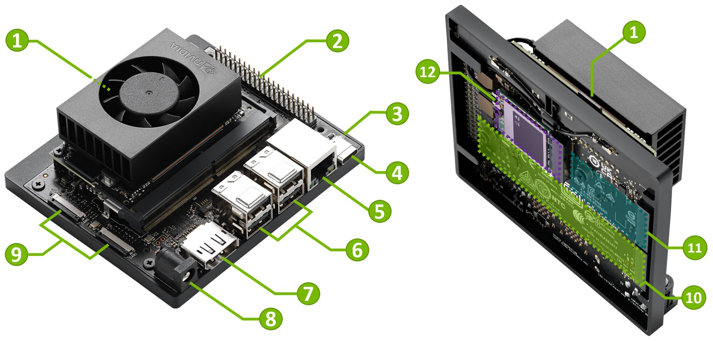

# Jetson Orin Nano 開發建置紀錄

Jetson Orin Nano 從燒錄系統、環境建置、遠端連線，到效能測試與 FLIR USB 相機連線的完整筆記。



## 文件導覽

| 文件 | 內容 |
| :--- | :--- |
| [document.md](document.md) | 主要建置文件：硬體規格、系統燒錄（SD 卡 / SDK Manager）、套件管理、SSH 與 Tailscale 遠端連線、開發環境規範、效能評估（ResNet）、JTOP 監控、Headless AnyDesk 黑畫面排查、任務規劃 |
| [SpinView_SDK.md](SpinView_SDK.md) | FLIR Blackfly S 相機透過 Spinnaker SDK 連線的除錯報告：偵測不到相機的原因、修復步驟、驗證結果 |

## 環境

- 開發板：NVIDIA Jetson Orin Nano
- 作業系統：Ubuntu 22.04
- 相機：FLIR Blackfly S BFS-U3-50S4M（USB 3）
- 相機 SDK：Spinnaker 4.3.0.189

## 資料夾結構

```text
.
├── README.md          # 本檔案
├── document.md        # Jetson 建置主文件
├── SpinView_SDK.md    # FLIR 相機連線除錯報告
└── images/            # 文件用到的所有截圖與照片
```
