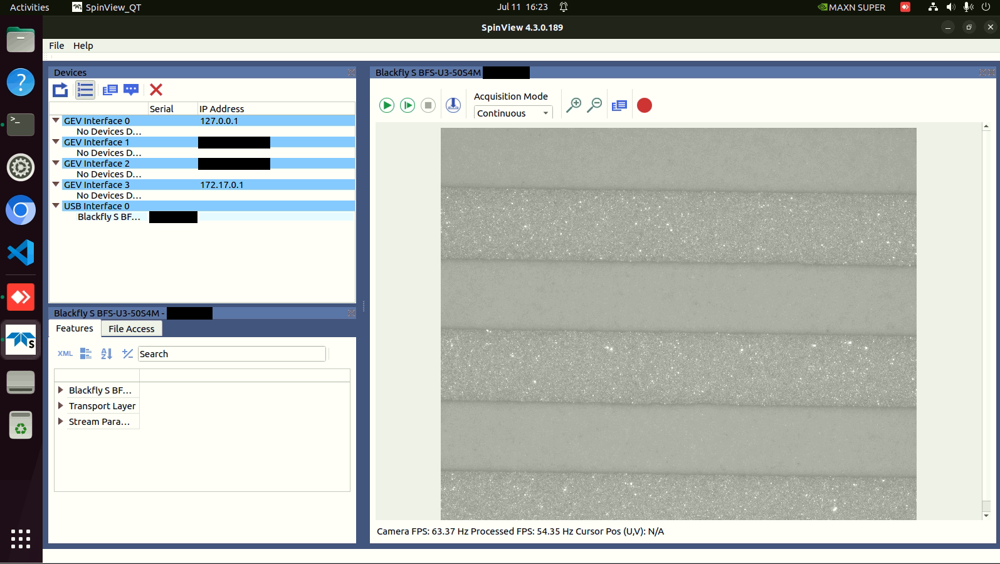

# Jetson Nano 與 FLIR Spinnaker USB 相機連線除錯報告

## 1. 系統與硬體環境
- 執行平台：Jetson Nano (ARM 架構)
- 作業系統：Ubuntu 22.04
- Spinnaker SDK 版本：4.3.0.189
- 相機型號：FLIR Blackfly S BFS-U3-50S4M (Vendor ID: 1e10)
- 執行帳戶：`<your_username>`

## 2. 異常現象描述
相機透過 USB 實體線路連接至 Jetson Nano 後，作業系統底層（可透過 `lsusb -t` 確認）可正確識別硬體設備，且 USB-FS 緩衝記憶體已正確配置為 1000 MB。然而，在一般使用者權限下執行 SpinView 或 Enumeration 工具時，系統回報「Number of cameras detected: 0」，無法正常列舉設備。

可透過以下指令確認系統是否有抓到 USB 裝置：
```bash
lsusb -t
dmesg | grep -i usb
```

## 3. 工程除錯歷程
為釐清根本原因，本案執行了以下隔離測試與參數驗證：
1. 權限隔離測試：以超級使用者權限執行 Enumeration，系統成功列舉出相機設備。此結果證實硬體與底層驅動無虞，問題侷限於使用者空間（User-space）的存取權限。
```bash
sudo -E /opt/spinnaker/bin/Enumeration
```
2. 群組狀態查核：執行 `groups` 檢視帳戶權限，發現當前帳戶未具備 SDK 預設所需的相機存取群組權限。
```bash
groups
```
3. udev 規則解析：檢視 `/etc/udev/rules.d/40-flir-spinnaker.rules`，發現系統將 Vendor ID `1e10` 設備指派給 `flirimaging` 群組。然而系統中並未建立該群組，且原始規則缺少 `MODE="0666"` 的讀寫授權參數。
```bash
cat /etc/udev/rules.d/40-flir-spinnaker.rules
```

## 4. 具體修復步驟
基於上述診斷，實施以下系統底層配置修正：

步驟一：修正 udev 規則以賦予讀寫權限
執行以下指令覆寫規則檔案，加入明確的權限參數 `MODE="0666"`：
```bash
echo 'SUBSYSTEM=="usb", ATTRS{idVendor}=="1e10", GROUP="flirimaging", MODE="0666"' | sudo tee /etc/udev/rules.d/40-flir-spinnaker.rules
echo 'SUBSYSTEM=="usb", ATTRS{idVendor}=="1724", GROUP="flirimaging", MODE="0666"' | sudo tee -a /etc/udev/rules.d/40-flir-spinnaker.rules
```

步驟二：手動建立缺失的系統群組並指派使用者
由於安裝腳本未能自動建立該群組，透過手動方式補齊，並載入新群組：
```bash
sudo groupadd flirimaging
sudo usermod -a -G flirimaging $USER
newgrp flirimaging
```

步驟三：重新載入規則與遠端硬體重置
在無法實體接觸設備的限制下，透過核心 sysfs 介面強制解綁與重新綁定 USB 節點。
可先透過 `ls /sys/bus/usb/devices/` 或是 `lsusb -t` 確認相機所在的 USB 節點（本例中為 `2-1.2`），藉此模擬實體重新插拔，強制更新裝置權限：
```bash
sudo udevadm control --reload-rules
sudo udevadm trigger
echo '2-1.2' | sudo tee /sys/bus/usb/drivers/usb/unbind
sleep 2
echo '2-1.2' | sudo tee /sys/bus/usb/drivers/usb/bind
```

## 5. 驗證結果
完成上述設定並於當前終端機會話載入新群組後，以一般使用者權限（不加 sudo）再次執行 Enumeration 工具驗證：
```bash
/opt/spinnaker/bin/Enumeration
```

驗證輸出結果如下：
```text
Spinnaker library version: 4.3.0.189
Number of GenTL producers detected: 1
Number of interfaces detected: 5
Number of cameras detected: 1

*** QUERYING PRODUCERS ***
Producer Name: Spinnaker Mixed GenTL Producer
    FileName: Spinnaker_GenTL.cti
    ID: Spinnaker GenTL Producer
    Path: /opt/spinnaker/lib/spinnaker-gentl/Spinnaker_GenTL.cti
    FilePath: Spinnaker_GenTL.cti

    Number of interfaces detected: 5
    Number of cameras detected: 1

*** QUERYING INTERFACES ***
GEV Interface 0
    No devices detected.
GEV Interface 1
    No devices detected.
GEV Interface 2
    No devices detected.
GEV Interface 3
    No devices detected.
USB Interface 0
    Device 0 FLIR Blackfly S BFS-U3-50S4M
```

結論：經修正作業系統之群組與讀寫權限配置後，一般使用者帳戶已可穩定列舉並操作 USB 相機。



