# Jetson Orin Nano 完整開發建置文件

> 本文件整合所有 Jetson Nano 相關筆記，涵蓋硬體規格、系統燒錄、遠端連線、環境建置、效能評估及問題排查，提供完整的開發部署標準作業程序。

---

## 目錄

1. [硬體規格與介面](#一硬體規格與介面)
2. [作業系統燒錄方法](#二作業系統燒錄方法)
3. [系統環境建置與套件管理原則](#三系統環境建置與套件管理原則)
4. [遠端連線與 SSH 設定](#四遠端連線與-ssh-設定)
5. [開發環境規範](#五開發環境規範)
6. [系統維護與環境初始化](#六系統維護與環境初始化)
7. [效能評估數據紀錄 (4/23)](#七效能評估數據紀錄-423)
8. [效能評估指標與測試結果 (4/30)](#八效能評估指標與測試結果-430)
9. [系統硬體監控 (JTOP)](#九系統硬體監控-jtop)
10. [Headless AnyDesk 黑畫面排查報告](#十headless-anydesk-黑畫面排查報告)
11. [任務規劃](#十一任務規劃)

---

## 一、硬體規格與介面

根據 NVIDIA 官方硬體規格，Jetson Orin Nano 開發板具備以下主要介面與擴充槽：

| 類別 | 規格說明 |
| :--- | :--- |
| **儲存與擴充** | microSD 卡插槽、40-pin 擴充排針 |
| **網路與通訊** | Gigabit Ethernet 網路埠 |
| **USB 介面** | USB-C（僅資料傳輸）× 1；USB 3.2 Type-A（10Gbps）× 4 |
| **影音與攝影機** | DisplayPort 輸出接頭；MIPI CSI 攝影機接頭（22-pin, 0.5mm pitch）× 2 |
| **M.2 擴充槽** | Key-M Type 2280（PCIe 3.0 x4）；Key-M Type 2230（PCIe 3.0 x2）；Key-E Type 2230 |
| **電源** | DC 電源插孔（5.5mm × 2.5mm） |

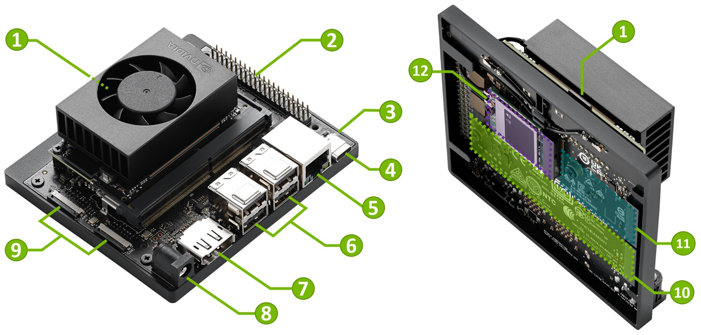

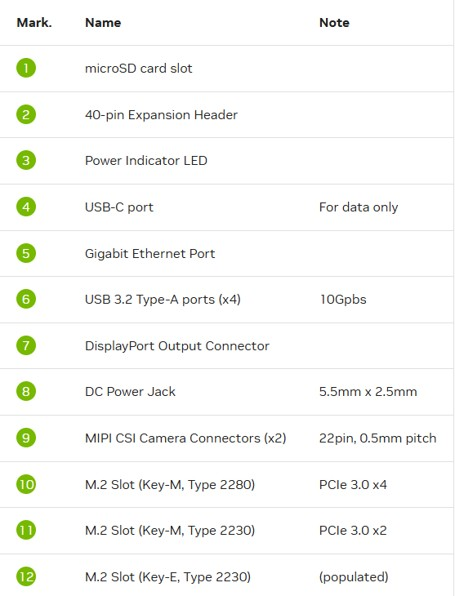

---

## 二、作業系統燒錄方法

### 1. SD 卡映像檔直接燒錄

- 此方法流程單純，適合用於初期的快速開機驗證。
- 操作方式為透過 Host PC 下載官方 JetPack 映像檔，利用 Rufus 等軟體製作開機碟，完成後將 microSD 卡插入 Orin Nano 即可開機。

### 2. 使用 NVIDIA SDK Manager 燒錄 NVMe SSD

- 此方式支援將作業系統與 JetPack 元件直接燒錄至 NVMe SSD，提供較高的安裝彈性。
- **重要限制**：Host PC 必須原生安裝 Ubuntu（通常為 20.04 或 22.04）的 Linux 系統。
- 不建議使用虛擬機，因容易發生 USB 連線中斷而導致燒錄失敗。
- Host PC 作業系統版本限制：曾嘗試使用外接 Type-C 硬碟盒運行 Ubuntu 24.04 LTS，SDK Manager 無法接受該版本；後續重灌為 Ubuntu 22.04 LTS 才得以繼續。

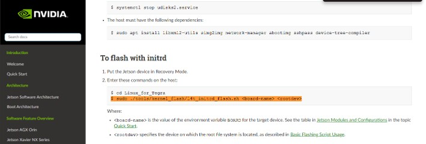

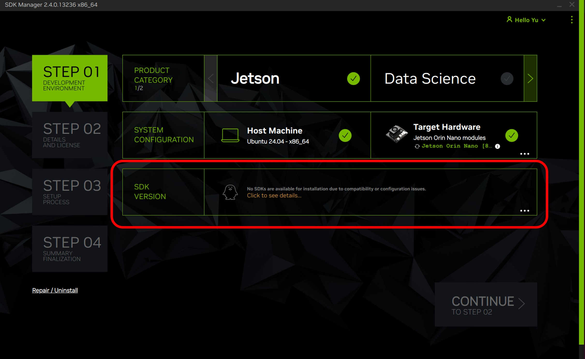

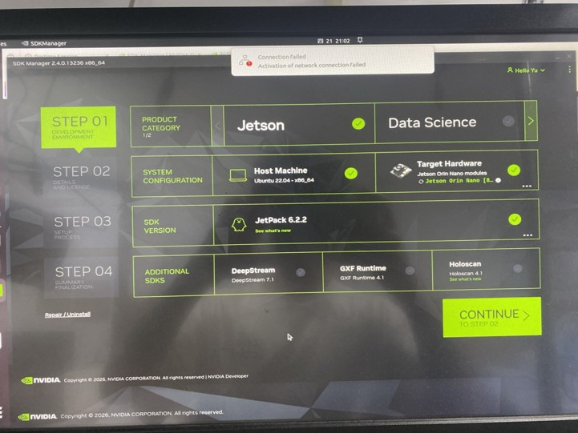

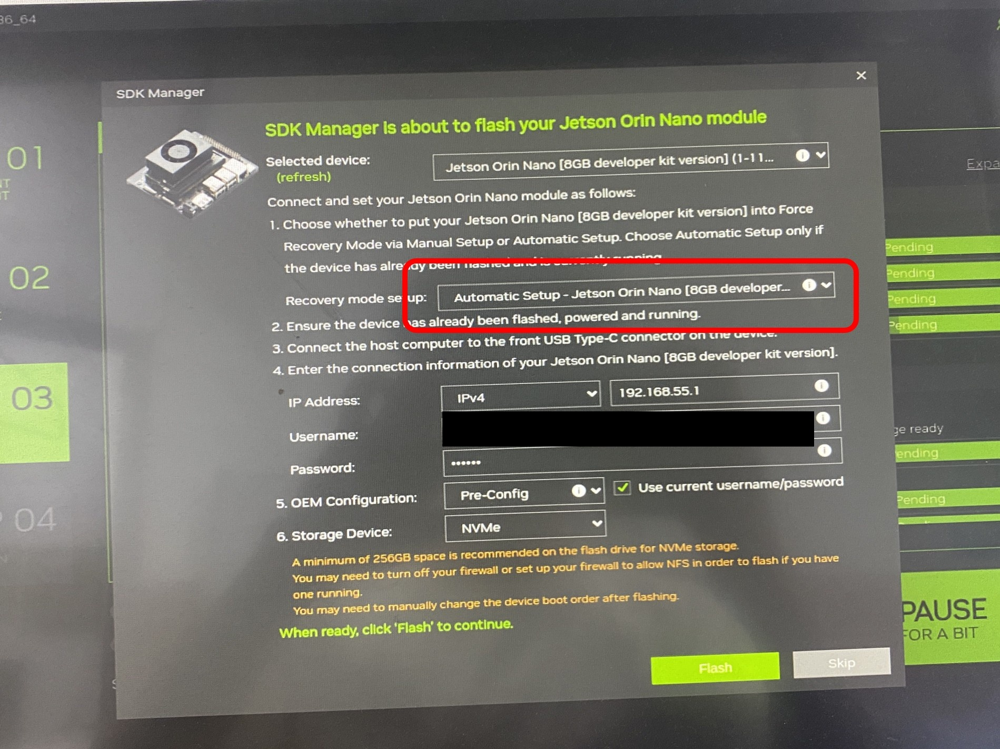

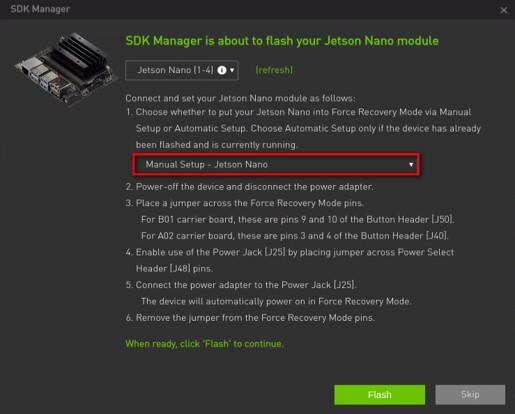

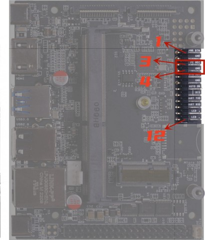

### 3. Linux 底層與硬體節點機制

- 主機端會從 NVIDIA 伺服器下載已壓縮的根檔案系統（Rootfs）打包檔，並在主機端解壓縮成完整的 Linux 資料夾結構。
- 燒錄腳本會改變擁有者設定（chown root:root），並賦予特殊執行權限（chmod 4755 - SetUID）。
- ⚠️ 由於 NTFS 格式無法儲存 SetUID 標記，也無法辨識裝置節點，若使用 NTFS 格式會導致 Jetson 開機後找不到硬體。

### 4. 強制恢復模式 (Force Recovery Mode) 操作

- 全新的 NVMe SSD 內部並無開機載入程式（Bootloader）。
- 在 SDK Manager 中須選擇 Manual Setup 進行燒錄配置。
- **實體硬體操作步驟**：
  1. 將設備斷電
  2. 短接 J14 排針上的 **Pin 9 (GND)** 與 **Pin 10 (FC REC)**
  3. 通電開機，使裝置進入強制恢復模式 (RCM)

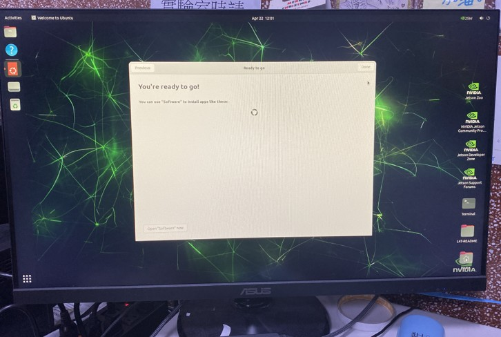

---

## 三、系統環境建置與套件管理原則

### 套件更新規範（重要）

| 指令 | 說明 | 是否允許 |
| :--- | :--- | :---: |
| sudo apt update | 僅同步遠端軟體清單，安全且必要 | ✅ 允許 |
| sudo apt upgrade | 實質檔案替換，可能覆蓋客製化驅動設定 | ❌ 禁止 |

- Jetson 系統依賴大量客製化的硬體驅動設定檔，升級過程中若誤觸覆蓋，將引發**無法開機**的風險。

### Docker 容器化環境部署

第一階段：確認 Docker 服務狀態
```
sudo apt update
sudo systemctl status docker
```

第二階段：建立專案資料夾
```
mkdir -p ~/inference_project
```

第三階段：確認 L4T 版本
```
cat /etc/nv_tegra_release
```
紀錄顯示為 R36(release), revision: 5.0

第四階段：啟動 GPU 加速的 PyTorch 容器（針對 L4T R36.5.0）：
```
sudo docker run -it --rm \
  --runtime nvidia \
  --network host \
  -v ~/inference_project:/workspace \
  nvcr.io/nvidia/l4t-pytorch:r36.2.0-pth2.2-py3 \
  bash
```

| 參數 | 說明 |
| :--- | :--- |
| -it | 保持標準輸入開啟並分配虛擬終端機，供互動操作 |
| --rm | 容器停止後自動刪除，避免佔用空間 |
| --runtime nvidia | 指定 NVIDIA Container Runtime，使容器能存取實體 GPU |
| --network host | 直接共用宿主機網路介面，省去通訊埠映射 |
| -v | Bind Mount，將宿主機資料夾對映至容器內，確保資料同步保留 |

---

## 四、遠端連線與 SSH 設定

### 1. 建立 Tailscale 虛擬內網

導入 Tailscale 作為連線基礎，可繞過家用 NAT 限制，直接在 Windows 主機與 Jetson 之間建立點對點的加密通道。

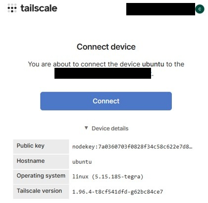

安裝指令（在 Jetson 終端機執行）：
```
curl -fsSL https://tailscale.com/install.sh | sh
sudo tailscale up
```

### 2. VS Code Remote - SSH

使用 VS Code Remote - SSH 擴充功能方便修改程式碼，且專案結構一目了然，並支援 Terminal 直接連線操作。

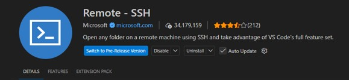

### 3. 設定 SSH 免密碼登入 (公私鑰對)

步驟 A：在 Windows 產生金鑰
```
ssh-keygen -t ed25519
cat C:\Users\<您的使用者名稱>\.ssh\id_ed25519.pub
```

步驟 B：將公鑰註冊至 Jetson
```
mkdir -p ~/.ssh
nano ~/.ssh/authorized_keys
chmod 700 ~/.ssh
chmod 600 ~/.ssh/authorized_keys
```

SCP 檔案傳輸範例：
```
scp -r D:\jetson_host Jetson-Orin-Nano:~/inference_project/
```

---

## 五、開發環境規範

| 端點 | 架構 | 環境 |
| :--- | :--- | :--- |
| **Windows 端** | X86 硬體架構 | Miniconda 環境 |
| **Ubuntu (Jetson) 端** | ARM64 硬體架構 | Docker 容器環境 |

- 官方提供的 PyTorch Wheel 本身已包含特規的 CUDA 加速支援。
- 安裝其他相關套件時，需極度小心避免 torch、torchvision 等核心套件被覆蓋。
- 需避免覆蓋的套件包含：**OpenCV**、**realesrgan** 與 **aura-sr** 等。

---

## 六、系統維護與環境初始化

- **禁止事項**：請勿執行 sudo apt upgrade。
- **正確做法**：僅執行 sudo apt update 進行軟體清單同步。
- **理由**：Jetson 系統依賴大量客製化的硬體驅動設定檔，升級過程中若誤觸覆蓋，將引發無法開機的風險。

系統狀態檢查：
```
sudo apt update
sudo systemctl status docker
```

---

## 七、效能評估數據紀錄 (4/23)

針對 ResNet-50 架構進行的壓力測試與效能驗證數據：

### 測試條件

- Batch Size：32，輸入張量為 3 通道 RGB，解析度 224×224
- 進行了 10 次 GPU 暖機程序（Warm-up），後續執行 50 次迴圈的核心效能評估

### 硬體狀態紀錄

- 測試前記憶體分配：torch.Size([32, 3, 224, 224])
- 溫度監測：CPU 最高溫度約 **53.2°C**，GPU 最高溫度約 **54.1°C**

### 系統吞吐量 (Throughput)

- 測試 FPS 結果：**144.19 FPS** 與 **147.41 FPS**

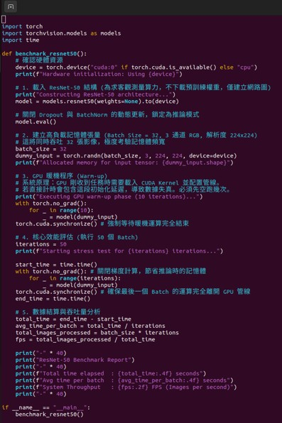

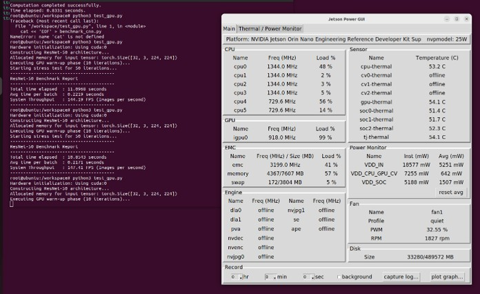

### 電源監測 (Power Monitor)

| 電源節點 (Name) | 瞬間功耗 (Inst mW) | 平均功耗 (Avg mW) |
| :--- | :--- | :--- |
| VDD IN | 18577 mW | 5251 mW |
| VDD CPU_GPU CV | 7255 mW | 642 mW |
| VDD SOC | 5188 mW | 1507 mW |

---

## 八、效能評估指標與測試結果 (4/30)

### 效能評估指標 (Metrics)

| 指標 | 說明 |
| :--- | :--- |
| **Setup time (sec)** 初始化時間 | 建立 SR 模型並將權重載入至記憶體/GPU 所耗費的時間。屬一次性成本，可在連續處理大量影像時分攤 |
| **Mean time (sec)** 平均執行時間 | 所有測試樣本執行單次完整流程的平均耗時，為評估系統吞吐量的核心指標 |
| **Std time (sec)** 執行時間標準差 | 量化運算耗時的波動程度。數值越低，代表延遲越穩定、可預測性越高 |
| **Peak RSS (MB)** 峰值常駐集大小 | Python 進程在作業系統中所佔用的最大 RAM 容量，直接反映 OOM 風險 |
| **CUDA peak allocated (MB)** | PyTorch 運算過程中，實際被張量佔用的 GPU 記憶體最大值 |
| **CUDA peak reserved (MB)** | PyTorch 底層分配器預先向 GPU 佔用的最大記憶體區塊。評估 GPU 記憶體是否耗盡時應以此數值為準 |

### 測試結果評估

#### 運算時間成本與瓶頸

| 情境 | 平均處理時間 | 備註 |
| :--- | :--- | :--- |
| 無 SR 情境（基準） | 0.0654 秒/張 | 具備高度即時性 |
| 引入 RealESRGAN | 9.8687 秒/張 | 耗時增加約 150 倍 |
| RealESRGAN 初始化 | +2.9269 秒 | 一次性成本 |

#### 系統穩定性與實體記憶體

- RealESRGAN 時間標準差為 0.0992 秒，波動率約 1%，推論過程能維持相對穩定的延遲。
- 加入 RealESRGAN 後，Peak RSS 從 **525.72 MB** 攀升至 **2285.91 MB**（額外需求約 1.76 GB）。
- 對於 8GB 版本的 Jetson Nano 而言，此消耗尚在安全範圍內。

#### VRAM 顯示記憶體消耗

- 無 SR 情境下，CUDA 記憶體消耗為 **0.0 MB**（OpenCV 霍夫變換完全依賴 CPU）。
- RealESRGAN 運算時，CUDA 保留記憶體峰值達到 **1086.0 MB**。
- 透過切塊推理機制，成功將特徵圖限制在約 1 GB VRAM 消耗內。

#### AI Framework 推論框架比較

| 框架 | 推論時間 | 備註 |
| :--- | :--- | :--- |
| TensorRT | ~6 秒 | 速度最快 |
| OnnxRunTime | ~13 秒 | 中等 |
| PyTorch | >40 秒 | 耗時最長 |

- 測試過程中曾發生 Aura-V2 OOM 的狀況。

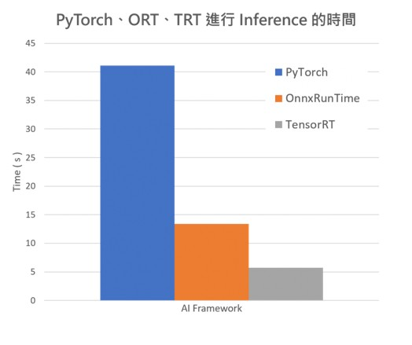

---

## 九、系統硬體監控 (JTOP)

- **設備資訊**：NVIDIA Jetson Orin Nano Engineering Reference Developer Kit Super [L4T 36.5.0]
- **溫度與負載**：GPU 溫度達 **68.88°C**，iGPU 負載達 **100%**
- **記憶體狀況**：GPU Shared RAM 使用量為 **1.2G / 7.4GB**，其中 Python 進程佔用約 **1.1G** 的 GPU 記憶體

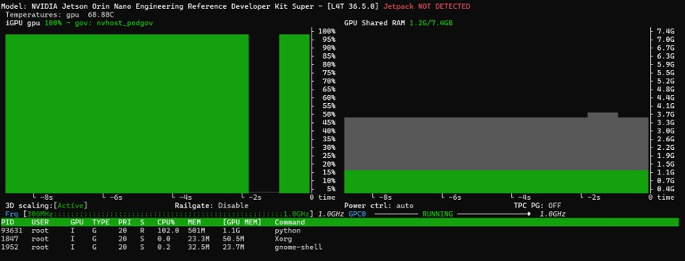

---

## 十、Headless AnyDesk 黑畫面排查報告

- **環境：** Jetson Nano / Ubuntu 22.04 / AnyDesk Headless 遠端連線
- **日期：** 2026-07-04

### 環境資訊

| 項目 | 說明 |
| :--- | :--- |
| **A 端（主機）** | Jetson Nano，Ubuntu 22.04，Tegra SoC（NVIDIA 整合 GPU） |
| **B 端（遠端）** | 一般 PC，透過 AnyDesk 連線至 A 端 |
| **連線方式** | AnyDesk system service（unattended access） |
| **問題情境** | Jetson Nano 重開機後未接螢幕（headless），B 端 AnyDesk 顯示黑畫面 |

### 問題排查與解法

#### 問題 1：確認系統是否正常開機

- **症狀：** AnyDesk 連線後顯示黑畫面，無法判斷是開機失敗或顯示問題。
- **排查方式：** 執行 ssh user@<jetson_ip>
- **結論：** SSH 可以連線，確認系統開機成功、網路正常，問題鎖定在顯示輸出層。

#### 問題 2：NVIDIA 驅動初始化失敗（無螢幕情況）

- **原因：** 未接螢幕時 NVIDIA 驅動偵測不到輸出裝置，X server 無法建立 screen。
- **解法：**
```
sudo nvidia-xconfig --allow-empty-initial-configuration
sudo reboot
```

#### 問題 3：modesetting 驅動與 NVIDIA 驅動搶佔 /dev/dri/card1

- **原因：** Jetson Nano 有兩顆 GPU（card0 給 NVIDIA，card1 是另一顆），Xorg 啟動時自動偵測並嘗試加入所有 GPU。
- **解法：** 執行 sudo nano /etc/X11/xorg.conf，在 ServerLayout section 加入：Option "AutoAddGPU" "false"，存檔後 sudo reboot。

#### 問題 4：AnyDesk 仍顯示黑畫面（無使用者桌面 session）

- **原因：** 系統未設定自動登入，開機後 gdm3 停在登入畫面。AnyDesk 在 Linux 上無法截取 GDM 登入畫面。
- **解法：** 執行 sudo nano /etc/gdm3/custom.conf，在 [daemon] section 設定：
```
AutomaticLoginEnable=true
AutomaticLogin=<your_username>
```
隨後執行 sudo reboot。
- ⚠️ **注意：** 自動登入會跳過密碼驗證，請確認實體存取安全性無虞再啟用。

#### 問題 5：AnyDesk 畫面顯示異常（解析度 640×480，畫面破碎）

- **原因：** 無螢幕情況下 NVIDIA 驅動只建立了 640×480 的最低限度虛擬 screen，xrandr 顯示 Monitors: 0。
- **解法：** 在 /etc/X11/xorg.conf 的 Device section 新增 ConnectedMonitor "DP-0" 與 UseDisplayDevice "DP-0"；在 Screen section 強制指定 Modes "1920x1080" 與 Virtual 1920 1080，隨後重開機。

### 最終 /etc/X11/xorg.conf 完整內容

```
Section "ServerLayout"
    Identifier     "Default Layout"
    Screen         "Default Screen" 0 0
    InputDevice    "Keyboard0" "CoreKeyboard"
    InputDevice    "Mouse0" "CorePointer"
    Option         "AutoAddGPU" "false"
EndSection

Section "Module"
    SubSection     "extmod"
        Option         "omit xfree86-dga"
    EndSubSection
    Load           "glx"
    Disable        "dri"
EndSection

Section "InputDevice"
    Identifier     "Keyboard0"
    Driver         "kbd"
EndSection

Section "InputDevice"
    Identifier     "Mouse0"
    Driver         "mouse"
    Option         "Protocol" "auto"
    Option         "Device" "/dev/mouse"
    Option         "Emulate3Buttons" "no"
    Option         "ZAxisMapping" "4 5"
EndSection

Section "Device"
    Identifier     "Tegra0"
    Driver         "nvidia"
    Option         "ConnectedMonitor" "DP-0"
    Option         "UseDisplayDevice" "DP-0"
EndSection

Section "Screen"
    Identifier     "Default Screen"
    Device         "Tegra0"
    DefaultDepth    24
    Option         "AllowEmptyInitialConfiguration" "True"
    SubSection     "Display"
        Depth       24
        Modes      "1920x1080"
        Virtual     1920 1080
    EndSubSection
EndSection
```

### 問題根因摘要

| 項目 | 說明 |
| :--- | :--- |
| **根因 1** | NVIDIA 驅動在 headless 情況下因無螢幕拒絕初始化 X screen |
| **根因 2** | Xorg 自動加入第二顆 GPU，modesetting 驅動搶佔 DRM master |
| **根因 3** | 開機後無使用者自動登入，AnyDesk 無桌面 session 可截圖 |
| **根因 4** | 無真實 monitor，虛擬 screen 解析度預設只有 640×480 |

---

## 十一、任務規劃

### 4/23 下周任務目標

1. 將程式佈署上線，並確認 VRAM 的使用量與執行速度。
2. 建立系統 Pipeline：啟動攝影機、於系統 UI 介面上點擊拍攝，以及執行孔洞或線寬偵測腳本，秀出偵測結果或影像。

### 4/30 下周任務規劃

1. 確認目前已無 VPN 需求，後續直接實體接線操作即可。
2. 確認 TensorRT 的執行速度確實較快，但相對地也需要消耗更多的記憶體（Memory）。
3. 安排實體空間以放置機台與 Jetson Nano，並規劃將線材接出以平板電腦進行展示。
4. 初期 UI 介面設計可先簡化，預計提供：丟入影像、量測線寬、孔洞量測等基本按鈕功能。

---

*本文件整合自以下原始資料：jetson.md、423/423.md、430/430.md、anydesk_headless.md，統一整理供後續維護參考。*
